# 📝 Awesome Rich Text Editing & Document Authoring 🚀

  <strong>A curated collection of industry-leading Rich Text Editors (WYSIWYG), collaborative document authoring suites, block-based canvases, and local-first knowledge engines.</strong>

  <a href="#-sector-overview--market-dynamics">Sector Overview</a> •
  <a href="#-saas--hosted-platforms">SaaS Platforms</a> •
  <a href="#-open-source-software">Open-Source Solutions</a> •
  <a href="#-feature-matrix--comparison-at-a-glance">Feature Matrix</a> •
  <a href="#-contributing">Contributing</a>

---

## 🔍 SEO & Technology Keywords
`rich-text-editor` • `document-authoring` • `collaborative-editor` • `wysiwyg` • `crdt` • `yjs` • `prosemirror` • `operational-transformation` • `block-editor` • `markdown-editor` • `self-hosted-office` • `digital-sovereignty` • `notion-alternative` • `google-docs-alternative`

---

## 📈 Sector Overview & Market Dynamics

The global market for office productivity and cloud collaboration software is valued at approximately **$81B–$118B** (with the dedicated document management & real-time collaborative authoring segment estimated between **$7.6B and $9.9B**, growing at a 12%–13.5% CAGR toward $25B+ by the early 2030s). The sector exhibits a **bifurcated, winner-takes-most concentration** at the enterprise baseline dominated by mega-cap platforms (**Microsoft 365** and **Google Workspace** capture over 85% of general enterprise document workloads), alongside a **moderately fragmented and rapidly innovating perimeter** where block-based canvases, modular knowledge bases (Notion, Coda), and sovereign self-hosted open-source CRDT/OT engines (AppFlowy, AFFiNE, La Suite Docs, Nextcloud) win specialized technical, academic, and privacy-first deployments.

---

## 📋 Table of Contents

- [📈 Sector Overview & Market Dynamics](#-sector-overview--market-dynamics)
- [🟦 SaaS / Hosted Platforms](#-saas--hosted-platforms)
  - [🏢 Enterprise SaaS Comparison Table](#-enterprise-saas-comparison-table)
  - [🔍 Deep-Dive SaaS Spotlights](#-deep-dive-saas-spotlights)
- [🟩 Open-Source Software](#-open-source-software)
  - [⭐ Open-Source Ecosystem Ranked by Popularity](#-open-source-ecosystem-ranked-by-popularity)
  - [🛠️ Detailed Open-Source Project Profiles](#️-detailed-open-source-project-profiles)
- [📊 Feature Matrix & Comparison at a Glance](#-feature-matrix--comparison-at-a-glance)
- [🤝 Contributing](#-contributing)
- [📄 License](#-license)

---

## 🟦 SaaS / Hosted Platforms

Commercial, cloud-hosted rich text editing, document authoring, and workspace platforms. Sorted in **descending order by company scale** (market capitalization / valuation / annual revenue).

### 🏢 Enterprise SaaS Comparison Table

| Product / Platform 💻 | Scale (Market Cap / Valuation / Revenue) 🏢 | Starting Tier Pricing 🏷️ | Free Tier Limits ⏳ | Key Focus & Modality 🎯 |
| :--- | :--- | :--- | :--- | :--- |
| **[Microsoft Word Online](https://www.microsoft.com/microsoft-365/word)** | **$3.1+ Trillion** (Market Cap) | **$6.00 / user / month** (*Microsoft 365 Business Basic*, annual commitment) | **Free Forever with Microsoft Account:** Includes free web/mobile editing of DOCX, 5 GB OneDrive cloud storage, real-time co-authoring & comments (excludes desktop applications). 30-day free trial available for Business Basic (up to 25 users). | DOCX standard, enterprise co-authoring, deep Office 365 suite integration |
| **[Google Docs](https://docs.google.com)** | **$2.1+ Trillion** (Alphabet Market Cap) | **$7.00 / user / month** (*Google Workspace Business Starter*, annual commitment) | **Free Forever with Google Account:** Unlimited document creation, real-time collaboration with live cursors & comments, sharing controls, capped by **15 GB pooled storage** across Drive, Gmail, & Photos. 14-day free trial for Workspace Business Starter. | Frictionless browser co-editing, live cursors, universal collaboration |
| **[Quip](https://quip.com)** *(Salesforce)* | **$310+ Billion** (Salesforce Market Cap; Quip ~$750M acq.) | **$10.00 / user / month** (*Quip Starter*, billed annually) | **30-Day Free Trial:** Full access to collaborative docs, spreadsheets, and chat for up to 10 team members. No permanent free tier exists for Quip; subscription required after 30 days. | CRM-embedded live document editing, spreadsheets with chat & audit log |
| **[Dropbox Paper](https://www.dropbox.com/paper)** | **$9.5+ Billion** (Dropbox Market Cap) | **$9.99 / month** (*Dropbox Plus*, billed annually) or **$15.00 / user / month** (*Standard Teams*) | **Free Forever with Dropbox Basic:** Unlimited Paper documents and co-editing, but total file storage and embedded media uploads are strictly constrained by the account's **2 GB free storage limit**. 30-day free trial on Dropbox Plus/Standard. | Minimalist clean document canvas, media embed integration, Dropbox sync |
| **[Notion](https://www.notion.so)** | **$10.0+ Billion** (Private Valuation) | **$10.00 / seat / month** (*Notion Plus*, billed annually; $12 month-to-month) | **Free Forever Plan:** Unlimited pages & blocks for 1 solo user, up to 10 guests, 5 MB file upload limit, and 7-day version history. *Multi-member limit:* If 2+ workspace members are added, the free plan is capped at a collective **1,000 blocks lifetime**. | Block-based documents, relational databases, wikis, and team knowledge bases |
| **[Coda](https://coda.io)** | **$1.4+ Billion** (Private Valuation) | **$10.00 / Doc Maker / month** (*Coda Pro*, billed annually; $12 month-to-month) | **Free Forever Plan:** Unlimited unshared docs, unlimited free editors/viewers, access to basic free packs, capped at **1 GB storage**, 7-day version history, and document size limits on table rows/objects once docs are shared. | All-in-one doc canvas combining interactive tables, buttons & automations |

---

### 🔍 Deep-Dive SaaS Spotlights

#### 📄 Microsoft Word Online
* **Overview:** The browser incarnation of Microsoft Word, delivering deep fidelity with `.docx` standards.
* **Collaboration:** Seamless co-authoring with track changes, threaded comments, and fluid desktop handoff.
* **Ecosystem:** Perfect for organizations deeply committed to the Microsoft 365, Teams, and SharePoint environments.

#### 📝 Google Docs
* **Overview:** The pioneer and standard of real-time collaborative cloud word processing.
* **Collaboration:** Instant zero-latency co-authoring, colored presence cursors, suggested edits, and Gemini AI writing helpers.
* **Ecosystem:** Standard for modern startups, education, and enterprises operating on Google Workspace.

#### 🤝 Quip
* **Overview:** Salesforce’s collaborative productivity suite combining docs, sheets, and conversation streams.
* **Collaboration:** Tight linking to Salesforce CRM objects, live bi-directional data synchronization, and integrated team chat.
* **Ecosystem:** Best suited for customer-facing sales and account teams needing living customer documentation.

#### 🗂️ Dropbox Paper
* **Overview:** Lightweight, sleek document workspace tightly coupled with Dropbox cloud storage.
* **Collaboration:** Rich interactive media embeds (code blocks, audio, Figma, YouTube), task lists, and calendar integration.
* **Ecosystem:** Excellent for design studios and creative teams already storing media assets in Dropbox.

#### 🧱 Notion
* **Overview:** Modular, block-based workspace unifying notes, project tracking, wikis, and structured databases.
* **Collaboration:** Real-time multi-user editing, granular page permissions, linked database views, and automated workflows.
* **Ecosystem:** Ideal for product teams, engineering squads, and cross-functional teams seeking adaptable structure.

#### ⚡ Coda
* **Overview:** A canvas that merges documents and spreadsheets with programmed logic, buttons, and external automations.
* **Collaboration:** Multi-user editing where only "Doc Makers" pay for authoring capabilities; all viewers and editors collaborate for free.
* **Ecosystem:** Geared toward ops teams needing interactive internal tools and data-driven documents.

---

## 🟩 Open-Source Software

Self-hosted, community-driven, and sovereign rich text editors, document authoring engines, and knowledge bases.

### ⭐ Open-Source Ecosystem Ranked by Popularity

The table below is sorted in **descending order by GitHub stargazers count**. Click any star badge to visit the project's stargazers community!

| Project 📦 | GitHub Stars ⭐ | Stack / Tech ⚙️ | License 📜 | Architecture / Category 🏛️ | Description & Strengths 💡 |
| :--- | :--- | :--- | :--- | :--- | :--- |
| **[AppFlowy](https://github.com/AppFlowy-IO/AppFlowy)** |  | Flutter / Rust | AGPL-3.0 | Local-First Block Workspace | High-performance open-source alternative to Notion. Delivers local-first data privacy, native desktop/mobile apps, customizable views, and grid/board/document capabilities. |
| **[AFFiNE](https://github.com/toeverything/AFFiNE)** |  | TypeScript / Rust (OctoBase) | MIT | Unified Docs + Infinite Canvas | Next-gen knowledge base merging structured block documents with an infinite whiteboard canvas (like Notion meets Miro) using CRDT sync. |
| **[Joplin](https://github.com/laurent22/joplin)** |  | TypeScript / Electron / React Native | AGPL-3.0 | Local-First Document & Note App | Secure, end-to-end encrypted note-taking and document authoring suite with Markdown/rich-text toggle, web clipper, and cloud sync (Nextcloud, S3, WebDAV). |
| **[Quill](https://github.com/slab/quill)** |  | TypeScript / JavaScript | BSD-3-Clause | WYSIWYG Editor Core & Engine | Powerful, modular rich-text editor with an expressive API, Parchment document model, and cross-platform consistency for web applications. |
| **[Logseq](https://github.com/logseq/logseq)** |  | ClojureScript / Electron | AGPL-3.0 | Privacy-First Outliner & Graph Doc | Privacy-first, local-first outliner and document authoring tool supporting Markdown and Org-mode with bi-directional linking and graph analysis. |
| **[Outline](https://github.com/outline/outline)** |  | TypeScript / React / Node.js | BSL-1.1 / Source-Available | Collaborative Team Knowledge Base | Fast, intuitive team knowledge base with real-time collaborative Markdown editing, multi-language code highlighting, and Slack/SSO integration. |
| **[Tiptap](https://github.com/ueberdosis/tiptap)** |  | TypeScript / ProseMirror | MIT | Headless Rich-Text Framework | Headless, unopinionated rich-text editor framework built on ProseMirror. Powers modern apps with collaborative extensions, slash menus, and AI integrations. |
| **[Editor.js](https://github.com/codex-team/editor.js)** |  | TypeScript / JavaScript | MIT | Block-Structured Document Editor | Block-styled editor designed to output clean, structured JSON data rather than raw HTML markup. Extensible with custom plugin blocks. |
| **[Slate](https://github.com/ianstormtaylor/slate)** |  | TypeScript / React | MIT | Customizable Rich-Text Framework | Completely customizable framework for building rich-text editors in React, utilizing an immutable data model and plugin architecture. |
| **[Lexical](https://github.com/facebook/lexical)** |  | TypeScript / JavaScript | MIT | Extensible Web Text Engine | Meta's extensible JavaScript web text-editor framework emphasizing reliability, accessible UI, and high-performance editing state trees. |
| **[Etherpad](https://github.com/ether/etherpad-lite)** |  | JavaScript / Node.js | Apache-2.0 | Collaborative Operational Transform Pad | Battle-tested, real-time collaborative document editor with sub-second synchronization via operational transformations and extensive plugin ecosystem. |
| **[La Suite Docs](https://github.com/suitenumerique/docs)** |  | Django / React / BlockNote / Yjs | MIT | Sovereign Block Collaborative Editor | Sovereign French DINUM & European-backed collaborative document editor. Offers slash commands, Yjs real-time co-authoring, and sovereign AI writing helpers. |
| **[TinyMCE](https://github.com/tinymce/tinymce)** |  | TypeScript / JavaScript | GPL-2.0+ / Commercial | Classic WYSIWYG HTML Editor | The web's classic rich text editor providing comprehensive HTML editing capabilities, table handling, spellcheck, and enterprise document workflows. |
| **[BlockNote](https://github.com/TypeCellOS/BlockNote)** |  | TypeScript / ProseMirror / Yjs | MIT / GPL-3.0 | Block-Based Notion-Style Component | Notion-style block-based rich text editor component for React, built on ProseMirror and Yjs with built-in real-time collaboration and slash menus. |
| **[ProseMirror](https://github.com/ProseMirror/prosemirror)** |  | TypeScript / JavaScript | MIT | Document Schema & Engine Toolkit | Foundational toolkit for building rich-text editors based on schema-governed document structures, modular transactions, and collaborative state trees. |
| **[CryptPad](https://github.com/cryptpad/cryptpad)** |  | JavaScript | AGPL-3.0 | Zero-Knowledge Encrypted Office | End-to-end encrypted, zero-knowledge collaborative office suite including rich text documents, spreadsheets, presentations, code pads, and whiteboards. |
| **[HedgeDoc](https://github.com/hedgedoc/hedgedoc)** |  | TypeScript / Node.js | AGPL-3.0 | Real-Time Collaborative Markdown Pad | Real-time collaborative Markdown editor with live preview, math typesetting (MathJax), diagrams (Mermaid, PlantUML), and presentation mode. |
| **[ONLYOFFICE Document Server](https://github.com/ONLYOFFICE/DocumentServer)** |  | C++ / JavaScript | AGPL-3.0 | High-Fidelity Office Document Server | Self-hosted online office suite with near 100% Microsoft Office compatibility for text documents, spreadsheets, and presentations with collaborative modes. |
| **[Alexandrie](https://github.com/Smaug6739/Alexandrie)** |  | Go / Vue / Nuxt | Open-Source (MIT) | Self-Hosted Privacy Note-Taking | Self-hosted knowledge management and note-taking platform with PWA offline-first support, rich Markdown editor, fast search, and S3-compatible storage. |
| **[Nextcloud RichDocuments](https://github.com/nextcloud/richdocuments)** |  | PHP / JavaScript / Collabora | AGPL-3.0 | Federated Sovereign Office Suite | The collaborative document editing module for Nextcloud (Nextcloud Write / Office), delivering real-time DOCX/ODT co-editing, versioning, and federated sharing. |
| **[Furqan Papyrus](https://github.com/FurqanSoftware/papyrus)** |  | Go / JavaScript | BSD-3-Clause | Lightweight OT Markdown Pad | Real-time collaborative Markdown document editor and repository built with operational transformations and project workspaces. |
| **[LyX (Mirror)](https://github.com/cburschka/lyx)** |  | C++ / Qt | GPL-2.0+ | WYSIWYM Academic Document Processor | Advanced document processor encouraging structure-first writing (WYSIWYM) backed by TeX/LaTeX typesetting, mathematical formulas, and thesis layouts. |
| **[TypstPad](https://github.com/dbccccccc/TypstPad)** |  | Go / Typst / Yjs | Open-Source | Collaborative Typst Document Editor | "Overleaf for Typst": self-hosted collaborative typesetting editor with instant WASM previews, track changes, comment anchors, and LLM agent integration. |
| **[Periwiki](https://github.com/danielledeleo/periwiki)** |  | Go / SQLite | Open-Source | Zero-JS Server-Rendered Wiki | Lightweight, zero-JavaScript wiki inspired by MediaWiki, powered by Goldmark CommonMark with WikiLink syntax and instant single-binary setup. |
| **[Libera Suite (Words)](https://github.com/abilian/libera-suite)** |  | Python / Euro-Office | AGPL-3.0 | Local-First Desktop Word Suite | Local-first desktop office suite derived from Euro-Office for offline editing of `.docx`, `.odt`, `.rtf`, and `.md` documents with zero cloud telemetry. |

---

### 🛠️ Detailed Open-Source Project Profiles

#### 🦹 [AppFlowy](https://github.com/AppFlowy-IO/AppFlowy)
* **Stack:** Flutter / Rust | **License:** AGPL-3.0
* **Key Features:** Built as a direct open-source alternative to Notion, AppFlowy places user data sovereignty first. Offers cross-platform native performance, modular boards, database views, and offline-first encryption.

#### 🎨 [AFFiNE](https://github.com/toeverything/AFFiNE)
* **Stack:** TypeScript / Rust (OctoBase) | **License:** MIT (Community Edition)
* **Key Features:** Combines structured block docs with an infinite freehand canvas. Seamlessly toggle between reading, writing, and visual mind mapping. Fully self-hostable with native local storage and CRDT sync.

#### 🔒 [Joplin](https://github.com/laurent22/joplin)
* **Stack:** TypeScript / Electron / React Native | **License:** AGPL-3.0
* **Key Features:** Local-first, end-to-end encrypted note-taking and document organizer. Features side-by-side Markdown editing, PDF/web clipping, file attachments, and synchronization across Nextcloud, Dropbox, and S3.

#### 📑 [Outline](https://github.com/outline/outline)
* **Stack:** TypeScript / React / Node.js | **License:** BSL-1.1 / Source-Available
* **Key Features:** Blazing fast team documentation platform. Supports real-time collaborative Markdown editing, slash commands, file attachments, dark mode, multi-tenant workspace permissions, and enterprise SSO.

#### 🧩 [Tiptap](https://github.com/ueberdosis/tiptap)
* **Stack:** TypeScript / ProseMirror | **License:** MIT
* **Key Features:** The industry standard headless wrapper around ProseMirror. Unopinionated and framework-agnostic (React, Vue, Svelte, vanilla JS), providing complete UI control with collaborative extensions and AI capabilities.

#### 🇫🇷 [La Suite Docs](https://github.com/suitenumerique/docs)
* **Stack:** Django / React / BlockNote / Yjs | **License:** MIT
* **Key Features:** Developed by the French Interministerial Digital Directorate (DINUM) and supported by the German Center for Digital Sovereignty (ZenDiS). Provides sovereign block editing, live presence cursors, and local LLM writing helpers.

#### 🛡️ [CryptPad](https://github.com/cryptpad/cryptpad)
* **Stack:** JavaScript | **License:** AGPL-3.0
* **Key Features:** Built specifically for privacy enthusiasts and sensitive corporate communications. Encrypts all document content in the browser before sending it to the server, ensuring zero-knowledge storage.

#### 🏢 [Nextcloud RichDocuments / Write](https://github.com/nextcloud/richdocuments)
* **Stack:** PHP / Collabora / Euro-Office | **License:** AGPL-3.0
* **Key Features:** The core collaborative document engine powering Nextcloud Office. Provides real-time multi-user editing with DOCX and ODT fidelity, version history diffing, sovereign permissions, and federated server sharing.

---

## 📊 Feature Matrix & Comparison at a Glance

| Software / Solution 🛠️ | License 📜 | Deployment ☁️ | Real-Time Collab 👥 | Editing Modality 🖋️ | Sovereign / Self-Hosted 🛡️ | Ideal Use Case 🎯 |
| :--- | :--- | :--- | :---: | :--- | :---: | :--- |
| **Microsoft Word Online** | Proprietary | Cloud | ✅ Yes | Traditional Pages (DOCX) | ❌ No | Global enterprises standardized on M365 |
| **Google Docs** | Proprietary | Cloud | ✅ Yes | Traditional Pages | ❌ No | Universal real-time team collaboration |
| **Quip** | Proprietary | Cloud | ✅ Yes | Docs + Live CRM Sheets | ❌ No | Salesforce-centric customer document workflows |
| **Dropbox Paper** | Proprietary | Cloud | ✅ Yes | Clean Web Canvas | ❌ No | Creative teams with rich media embeds |
| **Notion** | Proprietary | Cloud | ✅ Yes | Modular Blocks + DBs | ❌ No | Product specs, agile roadmaps & wikis |
| **Coda** | Proprietary | Cloud | ✅ Yes | Programmable Canvas | ❌ No | Operational dashboards & automated doc workflows |
| **AppFlowy** | AGPL-3.0 | Self-Hosted / Native | ✅ (Cloud/Self) | Modular Blocks + DBs | ✅ Yes | Local-first privacy Notion alternative |
| **AFFiNE** | MIT | Self-Hosted / Web | ✅ Yes | Blocks + Infinite Canvas | ✅ Yes | Unified document writing & visual whiteboarding |
| **Joplin** | AGPL-3.0 | Self-Hosted / Local | 🔄 Sync | Rich Text / Markdown | ✅ Yes | Encrypted personal & team knowledge base |
| **Outline** | BSL-1.1 | Self-Hosted / Cloud | ✅ Yes | Collaborative Markdown | ✅ Yes | High-speed internal engineering knowledge bases |
| **Tiptap** | MIT | Embedded SDK | ✅ (w/ Yjs) | Headless Rich Text | ✅ Yes | Custom SaaS app rich-text UI integration |
| **La Suite Docs** | MIT | Self-Hosted / Web | ✅ Yes | Block-Based (BlockNote) | ✅ Yes | Sovereign European public and enterprise docs |
| **CryptPad** | AGPL-3.0 | Self-Hosted / Web | ✅ Yes | E2EE Rich Text & Sheets | ✅ Yes | Zero-knowledge, high-security collaborations |
| **Nextcloud Write** | AGPL-3.0 | Self-Hosted / Web | ✅ Yes | Full Office (DOCX/ODT) | ✅ Yes | Sovereign private cloud document authoring |
| **HedgeDoc** | AGPL-3.0 | Self-Hosted / Web | ✅ Yes | Real-time Markdown | ✅ Yes | Technical notes, code snippets & math equations |
| **LyX** | GPL-2.0+ | Desktop Local | ❌ No | WYSIWYM (TeX/LaTeX) | ✅ Yes | Scientific papers, dissertations & book authoring |
| **TypstPad** | Open-Source | Self-Hosted / Web | ✅ Yes | WASM Typst Preview | ✅ Yes | Collaborative modern academic & paper typesetting |

---

## 🤝 Contributing

Contributions are warmly encouraged! 🎉 If you know of an outstanding open-source rich text editor, document authoring framework, or collaborative writing tool:

1. **Fork the Repository** 🍴
2. **Create a Feature Branch** (`git checkout -b feature/add-new-tool`)
3. **Ensure Active Maintenance:** The project must have active maintenance or releases within the last 12 months.
4. **Follow Formatting Standards:** Include the project's name, GitHub star social badge, tech stack, license, and a concise 1–2 sentence description.
5. **Open a Pull Request** 🚀

---

## 📄 License

This compilation is dedicated to the public domain under the [Creative Commons CC0 1.0 Universal License](https://creativecommons.org/publicdomain/zero/1.0/). Listed software tools and brands remain property of their respective creators.

  Built with ❤️ by the open-source community. If this list helped your document authoring stack, don't forget to ⭐ star the repo!

